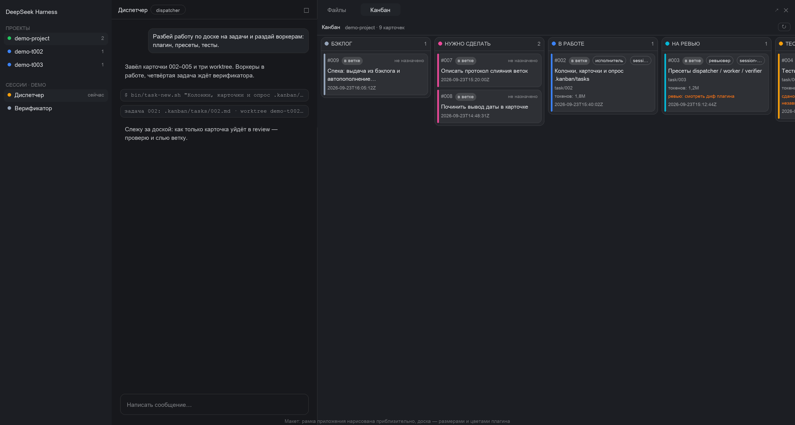
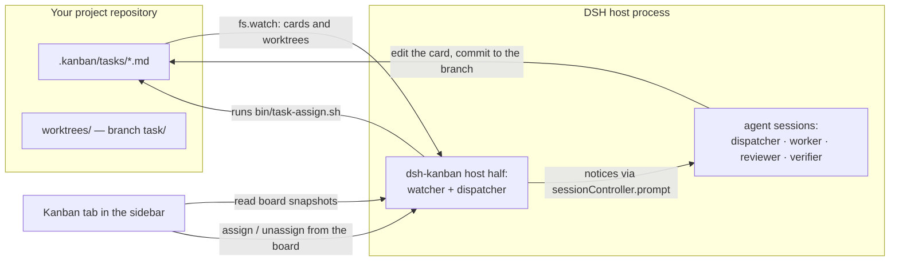
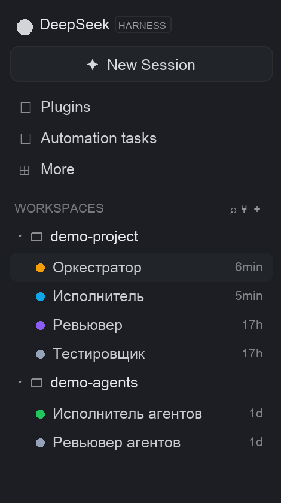
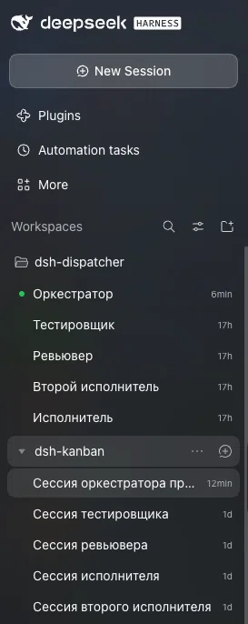
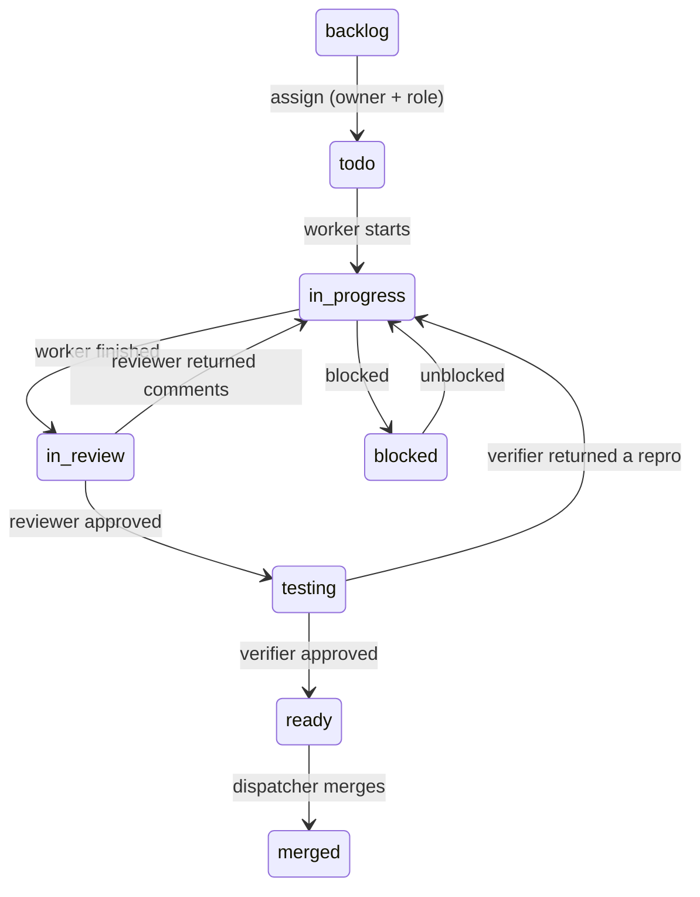
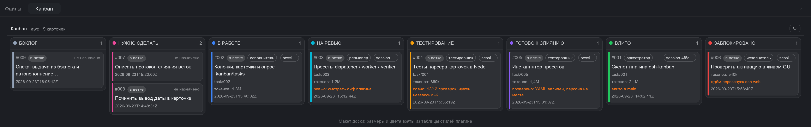
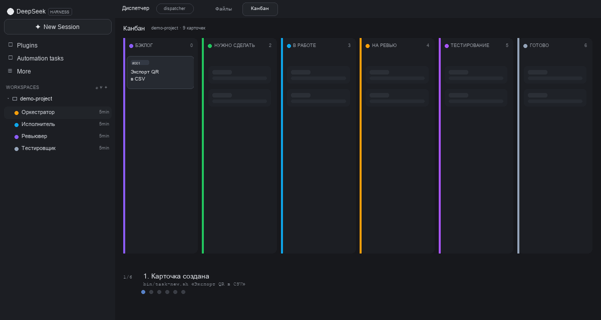

# dsh-kanban

**A Kanban board for agent teams inside [DeepSeek Harness](https://github.com/deepseek-ai/deepseek-harness) (DSH).**

[Русская версия](README.ru.md) · [Features](FEATURES.md) · [Full manual](KANBAN.md) · [Agent protocol](AGENTS.md) · [MIT licensed](LICENSE)



*One workspace, four role sessions and the board in the right sidebar. Most screenshots are
rendered by the plugin's own mockup generator from its real style table (so layout and colors
match the app); images marked "real screenshot" are actual UI captures.*

## Why this plugin exists

A chat with one agent is a single conversation: tasks are done one after another, and the
plan lives in the model's context. As soon as the work grows you want **roles** — someone
who plans and assigns, someone who implements, someone who reviews and someone who tests —
and you want them working **in parallel** without stepping on each other.

`dsh-kanban` turns that into a file-backed board:

- **The board is the single source of truth.** Every task is a Markdown card in
  `.kanban/tasks/<ID>.md` inside your git repository — with its status, owner, role, branch,
  token spend and notes. Nothing is locked inside a chat.
- **The plugin dispatches work.** Its host half watches the cards and sends *notices* to the
  right agent session: "this card is yours, take it", "a card waits for review", "the queue
  is short, refill it". No copy-pasting between chats.
- **Every task lives in its own git worktree and branch**, so parallel executors never edit
  the same files; merging is a scripted step, not manual git archaeology.
- **The board is a live view** in the right sidebar: columns, cards, owners, token usage and
  comments, updated every 3 seconds.

## How it works



1. **Cards are files.** Any edit to a card — by an agent or by you — is picked up by the host
   half; copies of the same card in a task worktree are merged by the newest `updated`.
2. **Roles are sessions.** You create ordinary DSH sessions and pick a **preset** when you
   create them: `dispatcher`, `worker`, `reviewer`, `verifier`. The presets ship with the
   plugin and are registered on startup, so plugin updates cannot lose them. The watcher
   recognises a session's role automatically (from the preset selection event) and stores the
   role map in `.kanban/.watcher-roles.json`.
3. **The dispatcher sends notices, not commands.** A notice is an ordinary queued prompt: the
   session reads the card, checks the real status and works. Agents keep their own
   conversation context for the whole task.

## Example: one workspace, four sessions

Create **one workspace** for your project — the repository root is fine — and four sessions
inside it:

| Session title | Preset | What it does |
|---|---|---|
| Dispatcher | `dispatcher` | slices the spec into backlog cards, assigns them, merges finished branches, keeps at most three tasks in flight |
| Executor | `worker` | takes an assigned card, works in its task worktree, commits to the branch, hands the card to review |
| Reviewer | `reviewer` | reads the diff: approves to testing, or returns the card with comments |
| Tester | `verifier` | runs tests and the manual scenario: approves to ready, or returns the card with a reproduction |



*Light theme: [workspace and sessions](dsh-kanban/docs/readme-sessions-light.png).*

The sidebar can group workspaces as a **tree** (the layout in the screenshot above): sessions live
under their workspace, and workspaces may be nested as sub-projects. Role presets are not shown in
the sidebar rows — the preset is visible in the session header and is listed in the table above.



*A real screenshot of the sidebar (no mockup): Workspaces tree with sessions of different roles.*

The flow of one task:



A concrete run (all commands are run in the **dispatcher session**, in the project root):

```bash
# 1. Slice a task: creates worktrees/007, branch task/007 and the card inside that branch
bin/task-new.sh "Fix the QR export"

# 2. Hand it to a free executor; the watcher wakes that session with a notice
bin/task-assign.sh 007

# ... the executor works:            todo -> in-progress -> in-review
# ... the reviewer checks the diff:  in-review -> testing
# ... the tester verifies:           testing -> ready
# ... then the dispatcher merges:
bin/task-commit.sh 007      # merge --no-ff, card -> merged, worktree removed
```

While this happens the board shows every transition; the card carries the branch, the owner,
the role and the token spend:



A light theme is available too: [panel](dsh-kanban/docs/board-mockup-panel-light.png) ·
[full board](dsh-kanban/docs/board-mockup-full-light.png).

**New to dsh-kanban?** Start with the **[onboarding guide](docs/onboarding.md)** — install,
connect your own project, build the four-role team and move the first card. *По-русски:
[онбординг](docs/onboarding.ru.md).*

## Quick start



The loop in one picture: a card is created, gets an owner, moves through the columns, and each
transition sends a watcher assignment to the role session.

1. **Install the plugin** — `bin/install-kanban.sh desktop` (or `web`) and restart DSH.
2. **Point it at your project** — set `boards` in `~/.dsh/cordis.patch.yml` (the profile patch,
   not the tracked file in the clone); restart and check `/tmp/dsh-kanban-watch.diag.json`.
3. **Put the task protocol into your project** — `bin/kanban-init.sh <project>`; commit
   and run `bin/doctor.sh`.
4. **Create the team** — one workspace, four sessions with presets `dispatcher`, `worker`,
   `reviewer`, `verifier`; open the **Kanban** tab in the right sidebar.
5. **Create the first card** — `bin/task-new.sh "Fix the QR export"`, assign it to the worker
   (GUI or `bin/task-move.sh 001 todo --owner <session-id>`) and watch it move.

Full walkthrough with commands and troubleshooting: **[onboarding guide](docs/onboarding.md)**
(*по-русски: [онбординг](docs/onboarding.ru.md)*).

## Install

**Requirements:** DeepSeek Harness `0.2.1-rc.3` (desktop app or `dsh web`) on macOS, `git` in
the project you want to manage, and `node` for the scripts (`bin/node.sh` finds it).

```bash
git clone https://github.com/VictorKozachek/dsh-kanban.git
cd dsh-kanban

# 1. Install the plugin into a DSH profile
bin/install-kanban.sh            # profile "web" (dsh web)
bin/install-kanban.sh desktop    # the Electron desktop app

# 2. Restart DSH: profiles read their bundle list on startup
```

The role presets are **part of the plugin** and are registered every time the plugin starts,
so there is no separate preset installation step and an update cannot lose them. If you are
upgrading from an older version that installed presets into the profile by hand, clean the
legacy block once:

```bash
bin/install-presets.sh --takeover
```

**Where the plugin watches.** `dsh-kanban/cordis.patch.yml` is the plugin's bundle patch. Set
the projects you want to manage:

```yaml
config:
  boards:                       # projects whose .kanban/tasks should be served
    - !!js process.env.HOME + '/projects/dsh-kanban'
  roots:                        # trees to scan for boards of nested workspaces
    - !!js process.env.HOME + '/projects/ai-fabric/aif-project'
  # ignore:                     # do not scan copies/experiments (globs: *, **)
  #   - !!js process.env.HOME + '/projects/ai-fabric/aif-project/**/tmp'
```

By default the paths are computed from `$HOME`; set them to your own project. Prefer a
**profile override** instead of editing the file in the clone (it is tracked by git) —
`~/.dsh/cordis.patch.yml`:

```yaml
- id: ui-kanban
  config:
    boards:
      - /absolute/path/to/your/project
    roots: []
```

After a restart, open a conversation, click **+** in the sidebar tab strip and add **Kanban**.
`worktrees/` and git worktrees are never scanned as separate boards; `ignore` is for other
copies (e.g. `tmp/` clones) that would otherwise duplicate the same cards.

**Verify the installation:**

```bash
bin/test.sh                              # full suite (490 checks), no network needed
bin/node.sh bin/host-shutdown-check.mjs  # real Host graceful-shutdown harness (4 scenarios)
```

## Creating sessions with presets

1. **Add the project as a workspace.** In the app sidebar add a workspace pointing at your
   repository root (for the example above, one workspace for the whole team).
2. **Create the dispatcher session.** New session → choose the **`dispatcher`** preset in the
   preset picker. This session runs the orchestrator role.
3. **Create the other roles.** In the same workspace create three more sessions and pick
   **`worker`**, **`reviewer`** and **`verifier`** as presets. Titles are free; naming them
   after their roles keeps the sidebar readable.
4. **Open the board.** Right sidebar → **+** → **Kanban**. The board reads the cards of the
   current workspace, so it appears as soon as the project has a `.kanban/tasks/` directory.
5. **Check that the roles were captured.** The watcher binds each session to its role from the
   preset selection event and stores the map in `.kanban/.watcher-roles.json` (gitignored).
   With a single worker `bin/task-assign.sh <id>` finds it automatically. For several
   executors, list their session IDs in `.kanban/.workers.json` — the order is the priority.

> **The preset is chosen at session creation.** DSH does not allow changing the preset of a
> session that has already started a turn. The plugin guards against the practical
> consequence — a lost preset definition — by registering the role presets itself, and there
> is an escape hatch for already-damaged logs: `bin/session-preset.sh` (offline, DSH must be
> closed). See [KANBAN.md](KANBAN.md).

**Isolation note.** With one workspace all role sessions share the same working directory:
the protocol keeps them apart, and every task still gets its own git worktree and branch, so
code changes do not overlap. If you also want filesystem isolation between roles, give each
executor its own workspace pointing at its `worktrees/<id>` directory — that is the strict
mode described in [KANBAN.md](KANBAN.md).

## The board

- Eight columns: `backlog → todo → in-progress → in-review → testing → ready → merged`,
  plus `blocked`. `backlog` is the neutral first column: sliced tasks that are not assigned
  yet — no owner, no role.
- A card shows its ID, title, role and owner session, the branch, token spend (per role in a
  tooltip), the note and the update time; an **"in branch"** badge means the card is read from
  a task worktree that is not merged yet.
- The **details panel** (click a card) shows the description, token breakdown, role/owner, the
  linked spec and all role comments.
- **You move cards with the mouse only between `backlog` and `todo`** — by drag and drop or
  with the duplicate buttons on the card. Forward is assignment: the card gets an owner and
  the executor gets a notice. Back to backlog clears the owner and role and is only allowed
  from `todo`. Every other transition is made by agents through `bin/task-move.sh`.
- **Child boards.** A parent session can keep a read-only overview of a tree of boards
  (`bin/board-children.sh` writes `.kanban/children.json`); the "Child boards" tab shows
  per-board counters and opens a child board read-only. The parent can look, not manage.
- **The rest of the UI:** polling every 3 s plus a ⟳ button, light and dark themes, and a
  mockup generator that renders the screenshots in this file from the real style table
  (`bin/render-mockup.sh`).

## Day-to-day commands

| Command | What it does |
|---|---|
| `bin/task-new.sh "Title"` | create `worktrees/<id>`, branch `task/<id>` and the card in that branch |
| `bin/task-new.sh "Title" --backlog` | slice a task into the backlog (no worktree) |
| `bin/task-assign.sh <id>` | assign a backlog card to the least loaded executor |
| `bin/backlog-fill.sh` | top up `todo` to `minTodo` (`.kanban/board.json`) from the backlog |
| `bin/task-move.sh <id> <status> --note "..."` | move a card; the card is committed to the current branch |
| `bin/task-commit.sh <id>` | merge the task branch (`--no-ff`), card → `merged`, remove the worktree |
| `bin/board-status.sh` | text dump of the board (`--json` for machines) |
| `bin/spec-new.sh "Title"` | create `.kanban/specs/<NNN>.md` for a feature spec |

Rules the protocol enforces: one `in-progress` per executor, at most three tasks in flight
(in-progress + in-review + testing), only the dispatcher assigns and merges, and `git push` is
a human step. The full agent protocol is in [AGENTS.md](AGENTS.md); the complete user manual
with architecture, isolation details and troubleshooting is in [KANBAN.md](KANBAN.md).

## Repository layout

| Path | What it is |
|---|---|
| `dsh-kanban/` | the DSH plugin: `lib/client.js` (board tab), `lib/index.js` (host watcher/dispatcher), `lib/watcher-core.js`, `lib/card-actions.js`, `lib/children.js`, `lib/presets.js` |
| `bin/` | 21 protocol and installation scripts (`task-*`, `board-*`, `spec-new`, `install-*`, `session-preset`, `test.sh`, `host-shutdown-check.mjs` …) |
| `.kanban/` | `board.json` (`minTodo`), `tasks/README.md` (card format); task cards and specs are local working history and are not published |
| `agent-presets/`, `presets/` | role preset sources and the generated preset artifact |
| `.agents/skills/` | the DSH skills `kanban` and `commit` |
| `FEATURES.md`, `FEATURES.ru.md` | the long feature list (English / Russian) |
| `KANBAN.md`, `AGENTS.md` | user manual and agent protocol |

## Requirements and verification

- DSH `0.2.1-rc.3`, macOS (bash 3.2), git; node comes from DSH via `bin/node.sh`.
- `bin/test.sh` — 490 checks, no network: card parsing, worktree merging, notice planning,
  client rendering without a browser, the assign channel, child boards, presets
  self-healing, graceful shutdown, scripts and locales.
- `bin/node.sh bin/host-shutdown-check.mjs` — boots a real Host process and checks that the
  plugin releases everything in time (the same path DSH uses when updating the app).
- Python is only needed for the mockup checks and rendering (`bin/render-mockup.sh --html`).

## License

[MIT](LICENSE).
