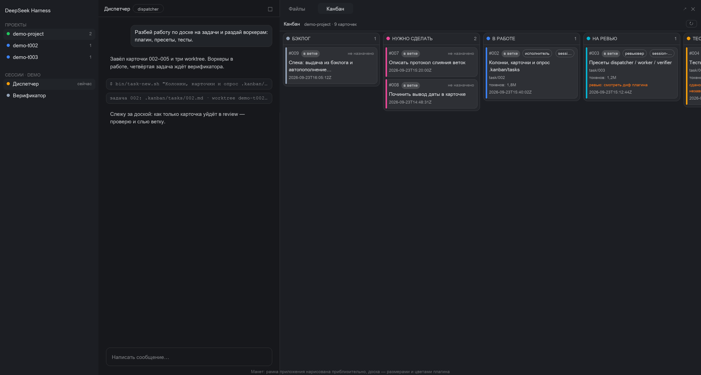
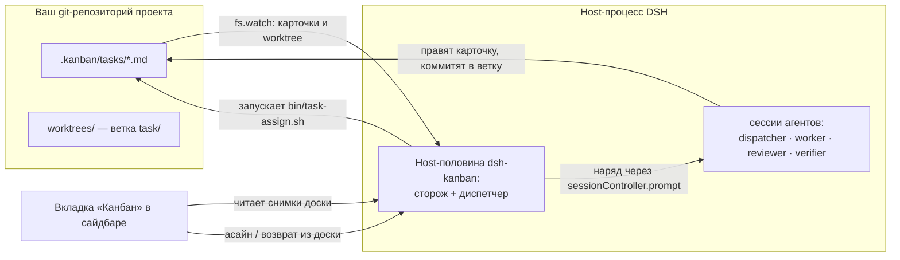
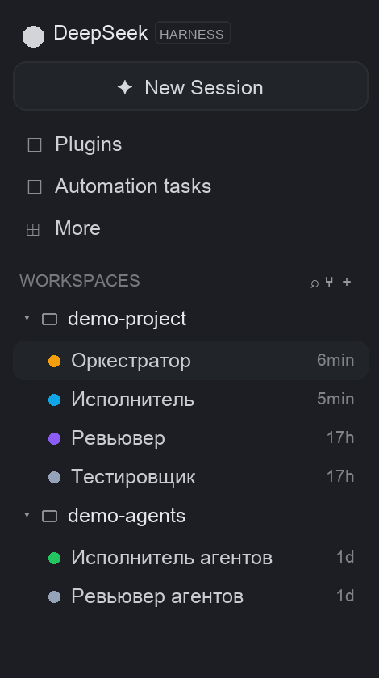
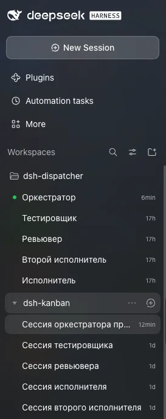
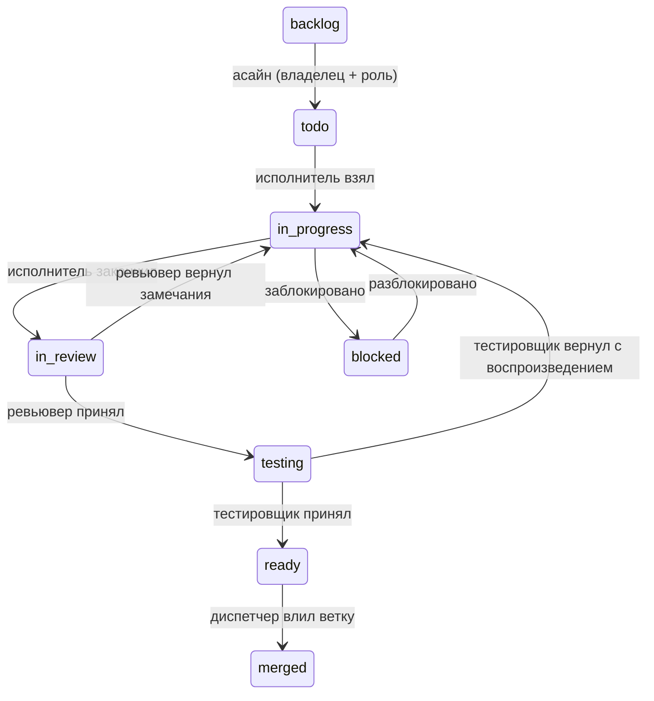
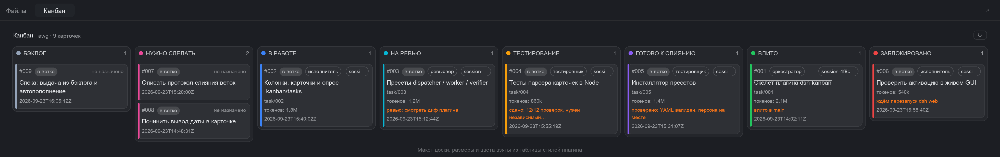

# dsh-kanban

**Канбан-доска агентских команд внутри [DeepSeek Harness](https://github.com/deepseek-ai/deepseek-harness) (DSH).**

[English version](README.md) · [Фичалист](FEATURES.ru.md) · [Полное руководство](KANBAN.md) · [Протокол агентов](AGENTS.md) · [Лицензия MIT](LICENSE)



*Один воркспейс, четыре сессии ролей и доска в правом сайдбаре. Большинство скриншотов
рисует собственный генератор макетов плагина — из его настоящей таблицы стилей, поэтому
раскладка и цвета как в приложении; кадры с пометкой «настоящий скриншот» сняты с живого UI.*

## Зачем этот плагин

Чат с одним агентом — это один разговор: задачи делаются последовательно, а план
живёт в контексте модели. Как только работы становится больше, нужны **роли** — кто-то
планирует и раздаёт, кто-то делает, кто-то проверяет код, кто-то тестирует — и нужно,
чтобы они работали **параллельно** и не мешали друг другу.

`dsh-kanban` превращает это в доску, которая живёт в файлах:

- **Доска — единственный источник правды.** Каждая задача — Markdown-карточка в
  `.kanban/tasks/<ID>.md` внутри вашего git-репозитория: статус, владелец, роль, ветка,
  расход токенов, заметки. Ничего не заперто в переписке.
- **Плагин сам раздаёт работу.** Host-половина наблюдает за карточками и отправляет
  *наряды* нужной сессии: «эта карточка твоя, бери», «карточка ждёт ревью», «очередь
  опустела, пополни». Копипасты между чатами нет.
- **Каждая задача — в своём git-worktree и ветке**, поэтому параллельные исполнители не
  правят одни и те же файлы; слияние — шаг скриптом, а не ручная археология по git.
- **Доска — живая картинка** в правом сайдбаре: колонки, карточки, владельцы, токены и
  комментарии, обновление раз в 3 секунды.

## Как это работает



1. **Карточки — это файлы.** Любое изменение карточки — агентом или вами — подхватывает
   host-половина; копии одной карточки в worktree задачи сливаются по свежести `updated`.
2. **Роли — это сессии.** Вы создаёте обычные сессии DSH и при создании выбираете
   **пресет**: `dispatcher`, `worker`, `reviewer`, `verifier`. Пресеты едут вместе с
   плагином и регистрируются при каждом старте, поэтому обновление плагина не может их
   потерять. Сторож сам понимает роль сессии (по событию выбора пресета) и хранит карту
   ролей в `.kanban/.watcher-roles.json`.
3. **Диспетчер отправляет наряды, а не команды.** Наряд — обычное сообщение в очереди
   сессии: она читает карточку, сверяет реальный статус и работает. Так у агента
   сохраняется собственный контекст задачи на весь её путь.

## Пример: один воркспейс, четыре сессии

Создайте **один воркспейс** на проект — подойдёт корень репозитория — и четыре сессии в
нём:

| Название сессии | Пресет | Что делает |
|---|---|---|
| Диспетчер | `dispatcher` | нарезает спеку в карточки бэклога, раздаёт их, вливает готовые ветки, держит не больше трёх задач в работе |
| Исполнитель | `worker` | берёт назначенную карточку, работает в её worktree, коммитит в ветку и отдаёт на ревью |
| Ревьювер | `reviewer` | читает диф: принимает в тестирование или возвращает карточку с замечаниями |
| Тестировщик | `verifier` | прогоняет тесты и ручной сценарий: принимает в ready или возвращает карточку с воспроизведением |



*Светлая тема: [воркспейс и сессии](dsh-kanban/docs/readme-sessions-light.png).*

Сайдбар умеет группировать воркспейсы **деревом** (как на скриншоте выше): сессии лежат внутри
своего воркспейса, а воркспейсы могут быть вложены как подпроекты. Пресеты в строках сессий не
показываются — пресет виден в шапке чата и в таблице ролей выше.



*Настоящий скриншот сайдбара (не макет): дерево Workspaces с сессиями разных ролей.*

Путь одной задачи:



Конкретный прогон (команды выполняются в **сессии диспетчера**, в корне проекта):

```bash
# 1. Нарезать задачу: создаёт worktrees/007, ветку task/007 и карточку внутри ветки
bin/task-new.sh "Починить экспорт QR"

# 2. Отдать свободному исполнителю; сторож разбудит его сессию нарядом
bin/task-assign.sh 007

# ... исполнитель работает:      todo -> in-progress -> in-review
# ... ревьювер смотрит диф:      in-review -> testing
# ... тестировщик проверяет:     testing -> ready
# ... дальше диспетчер вливает:
bin/task-commit.sh 007      # merge --no-ff, карточка -> merged, worktree убран
```

Всё это время доска показывает переходы, а карточка несёт ветку, владельца, роль и
расход токенов:



Есть и светлая тема: [панель](dsh-kanban/docs/board-mockup-panel-light.png) ·
[вся доска](dsh-kanban/docs/board-mockup-full-light.png).

## Установка

**Требования:** DeepSeek Harness `0.2.1-rc.3` (приложение или `dsh web`) на macOS, `git` в
проекте, которым хотите управлять, и `node` для скриптов (`bin/node.sh` найдёт его сам).

```bash
git clone https://github.com/VictorKozachek/dsh-kanban.git
cd dsh-kanban

# 1. Поставить плагин в профиль DSH
bin/install-kanban.sh            # профиль «web» (dsh web)
bin/install-kanban.sh desktop    # Electron-приложение

# 2. Перезапустить DSH: профиль читает список бандлов при старте
```

Пресеты ролей — **часть плагина**, они регистрируются при каждом его старте, поэтому
отдельного шага установки пресетов нет, и обновление их не теряет. Если вы обновляетесь
со старой версии, которая ставила пресеты в профиль руками, один раз уберите legacy-блок:

```bash
bin/install-presets.sh --takeover
```

**Где плагин следит за доской.** `dsh-kanban/cordis.patch.yml` — патч-слой бандла
плагина. Укажите там свои проекты:

```yaml
config:
  boards:                       # проекты, чьи .kanban/tasks обслуживаются
    - !!js process.env.HOME + '/projects/dsh-kanban'
  roots:                        # деревья, в которых сторож сам ищет доски воркспейсов
    - !!js process.env.HOME + '/projects/ai-fabric/aif-project'
  # ignore:                     # не обходить копии/эксперименты (шаблоны *, **)
  #   - !!js process.env.HOME + '/projects/ai-fabric/aif-project/**/tmp'
```

По умолчанию пути вычисляются от `$HOME` — укажите свой проект. Правьте не файл в клоне
(он под git), а **профильный override** `~/.dsh/cordis.patch.yml`:

```yaml
- id: ui-kanban
  config:
    boards:
      - /absolute/path/to/your/project
    roots: []
```

После перезапуска откройте разговор, нажмите **+** в полосе вкладок справа и добавьте
**«Канбан»**. `worktrees/` и git-worktree никогда не считаются отдельными досками, а
`ignore` отсекает прочие копии (например, клоны в `tmp/`).

**Проверить установку:**

```bash
bin/test.sh                              # весь набор (490 проверок), сеть не нужна
bin/node.sh bin/host-shutdown-check.mjs  # реальный graceful shutdown Host-процесса (4 сценария)
```

## Как создавать сессии с пресетами

1. **Добавьте проект как воркспейс.** В сайдбаре приложения добавьте воркспейс с путём к
   корню репозитория (для примера выше — один воркспейс на всю команду).
2. **Создайте сессию диспетчера.** Новая сессия → в выборе пресета возьмите
   **`dispatcher`**. Эта сессия выполняет роль оркестратора.
3. **Создайте остальные роли.** В том же воркспейсе создайте ещё три сессии и выберите
   пресеты **`worker`**, **`reviewer`** и **`verifier`**. Названия произвольные — удобно
   называть сессии по ролям.
4. **Откройте доску.** Правый сайдбар → **+** → **«Канбан»**. Доска читает карточки
   текущего воркспейса и появляется, как только в проекте есть `.kanban/tasks/`.
5. **Проверьте, что роли подхватились.** Сторож привязывает каждую сессию к роли по
   событию выбора пресета и хранит карту в `.kanban/.watcher-roles.json` (в `.gitignore`).
   Если исполнитель один, `bin/task-assign.sh <id>` найдёт его автоматически. Для
   нескольких исполнителей перечислите их id сессий в `.kanban/.workers.json` — порядок
   задаёт приоритет.

> **Пресет выбирается при создании сессии.** DSH не разрешает менять пресет сессии, у
> которой уже был ход. Плагин защищает от практического следствия — потери определения
> пресета — тем, что регистрирует пресеты ролей сам, а для уже пострадавших логов есть
> «аптечка»: `bin/session-preset.sh` (офлайн, DSH должен быть закрыт). Подробности —
> в [KANBAN.md](KANBAN.md).

**Про изоляцию.** В одном воркспейсе все сессии ролей делят рабочую директорию: их
разводит протокол, а каждая задача всё равно получает свой git-worktree и ветку, поэтому
правки кода не пересекаются. Если нужна ещё и файловая изоляция ролей — дайте каждому
исполнителю отдельный воркспейс на его `worktrees/<id>`: это «строгий режим», описанный в
[KANBAN.md](KANBAN.md).

## Доска

- Восемь колонок: `backlog → todo → in-progress → in-review → testing → ready → merged`,
  плюс `blocked`. `backlog` — нейтральная первая колонка: нарезанные, но ещё не выданные
  задачи, без владельца и роли.
- Карточка показывает id, название, роль и сессию-владельца, ветку, расход токенов (с
  разбивкой по ролям в подсказке), заметку и время обновления; значок **«в ветке»**
  означает, что карточка прочитана из worktree задачи, которая ещё не слита.
- **Панель деталей** (клик по карточке) показывает описание, расход по ролям,
  роль/владельца, связанную спеку и все комментарии ролей.
- **Мышью карточку можно двигать только между `backlog` и `todo`** — перетаскиванием или
  кнопками-дублями на карточке. Вперёд — асайн: карточка получает владельца, исполнителю
  уходит наряд. Назад в бэклог снимает владельца и роль и разрешён только из `todo`.
  Остальные переходы делают агенты через `bin/task-move.sh`.
- **Дочерние доски.** Родительская сессия может держать read-only обзор дерева досок
  (`bin/board-children.sh` пишет `.kanban/children.json`); вкладка «Дочерние доски»
  показывает счётчики по доскам и открывает доску ребёнка только для чтения. Родитель
  смотрит, но не управляет.
- **Остальное в UI:** опрос раз в 3 с и кнопка ⟳, светлая и тёмная темы, а макеты для
  скриншотов в этом файле рисуются из настоящей таблицы стилей (`bin/render-mockup.sh`).

## Повседневные команды

| Команда | Что делает |
|---|---|
| `bin/task-new.sh "Название"` | создать `worktrees/<id>`, ветку `task/<id>` и карточку в ветке |
| `bin/task-new.sh "Название" --backlog` | нарезать задачу в бэклог (без worktree) |
| `bin/task-assign.sh <id>` | выдать карточку из бэклога самому свободному исполнителю |
| `bin/backlog-fill.sh` | добрать `todo` до `minTodo` (`.kanban/board.json`) из бэклога |
| `bin/task-move.sh <id> <статус> --note "..."` | перевести карточку; карточка коммитится в текущую ветку |
| `bin/task-commit.sh <id>` | влить ветку задачи (`--no-ff`), карточка → `merged`, worktree убран |
| `bin/board-status.sh` | текстовый дамп доски (`--json` — машинный) |
| `bin/spec-new.sh "Название"` | завести спеку `.kanban/specs/<NNN>.md` |

Правила, которые держит протокол: один `in-progress` на исполнителя, не больше трёх задач
в работе (in-progress + in-review + testing), выдаёт и вливает только диспетчер, `git push` —
шаг человека. Полный протокол агентов — в [AGENTS.md](AGENTS.md); руководство с
архитектурой, деталями изоляции и диагностикой — в [KANBAN.md](KANBAN.md).

## Структура репозитория

| Путь | Что это |
|---|---|
| `dsh-kanban/` | сам плагин: `lib/client.js` (вкладка доски), `lib/index.js` (host-сторож/диспетчер), `lib/watcher-core.js`, `lib/card-actions.js`, `lib/children.js`, `lib/presets.js` |
| `bin/` | 21 скрипт протокола и установки (`task-*`, `board-*`, `spec-new`, `install-*`, `session-preset`, `test.sh`, `host-shutdown-check.mjs` …) |
| `.kanban/` | `board.json` (`minTodo`), `tasks/README.md` (формат карточки); карточки задач и спеки — локальная рабочая история, в репозиторий не публикуются |
| `agent-presets/`, `presets/` | заготовки пресетов ролей и сгенерированный артефакт пресетов |
| `.agents/skills/` | скилы DSH `kanban` и `commit` |
| `FEATURES.md`, `FEATURES.ru.md` | полный фичалист (английский / русский) |
| `KANBAN.md`, `AGENTS.md` | руководство пользователя и протокол агентов |

## Требования и проверки

- DSH `0.2.1-rc.3`, macOS (bash 3.2), git; node берётся из DSH через `bin/node.sh`.
- `bin/test.sh` — 490 проверок без сети: разбор карточек, слияние worktree-копий,
  планирование нарядов, рендер клиента без браузера, канал асайна, дочерние доски,
  самолечение пресетов, graceful shutdown, скрипты и локали.
- `bin/node.sh bin/host-shutdown-check.mjs` — поднимает настоящий Host-процесс и проверяет,
  что плагин освобождает всё вовремя (тот же путь, которым DSH обновляет приложение).
- Python нужен только для проверок и отрисовки макетов (`bin/render-mockup.sh --html`).

## Лицензия

[MIT](LICENSE).
