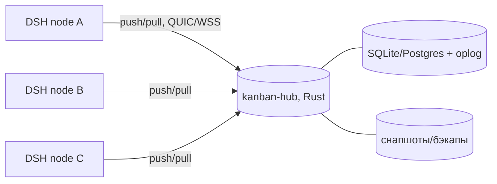

# Распределённая доска: концепт

Несколько DSH-инстансов (машины, сети) работают с одним проектом и общей доской.
Карточки должны сходиться, наряды — доходить до нужной сессии, а падение или
перегрузка одного инстанса не должны терять данные и ломать консистентность.

Это документ для решения: какую топологию и модель консистентности берём.
Кода пока нет.

## 1. Что уже есть и чего не хватает

Сейчас доска — **файлы** (`.kanban/tasks/*.md`) и **локальный сторож**:
он читает `cwd` сессий, пишет `.watcher-state.json`/`.watcher-pending.json` и
шлёт наряд через `sessionController.prompt`. Всё это живёт на одной машине.

Для распределённой работы не хватает:

- общей точки правды: у каждого инстанса сейчас своя копия файлов;
- синхронизации изменений (кто и когда сдвинул карточку);
- разрешения конфликтов (два инстанса одновременно двигают одну карточку);
- маршрутизации наряда: сессия-владелец живёт на конкретной машине;
- устойчивости: упал инстанс/хаб — ничего не потеряли, после подъёма догнали;
- работы в разрыве сети: изменения копятся локально и сливаются позже.

## 2. Модель данных

Карточка — не «файл», а **поток событий** (event-sourced):

```json
{
  "opId": "01J...ULID",
  "cardId": "042",
  "type": "card.status.changed",
  "value": "in-review",
  "hlc": "2026-11-11T16:02:03.123Z-0007-nodeA",
  "author": { "instance": "nodeA", "session": "session-…", "role": "worker" },
  "baseVersion": 17
}
```

- `opId` — идемпотентность (повторная доставка не создаёт дубль);
- `hlc` — гибридные часы (физическое время + логический счётчик + id узла);
- `baseVersion` — версия карточки, на которой основано изменение;
- сервер присваивает монотонный `seq`, клиенты догоняют по курсору `seq`.

Снимок карточки — проекция событий; файлы `.kanban/tasks/*.md` остаются
**проекцией для совместимости** (их пишет/читает плагин и `bin/task-*`).

Правила слияния по полям:

| Поле | Правило |
|---|---|
| `status` | LWW по HLC, но переходы валидируются; конфликт двух переходов → карточка в `conflicted`, решает диспетчер |
| `owner` | lease с TTL: владелец продлевает heartbeat; просрочен → `owner` снимается событием |
| `title`/`priority`/`spec` | LWW по HLC |
| заметки/комментарии | append-only, сливаются без потерь |
| удаление | только tombstone-событие, не физическое удаление |

## 3. Топология: три варианта

### A. Центральный хаб (рекомендую для MVP)



- один авторитетный журнал операций — конфликты сериализуются хабом;
- клиенты ходят только наружу (NAT/разные сети не мешают);
- падение хаба: клиенты копят outbox, после подъёма догоняют;
- HA: Postgres + standby/лидер-выборы (этап 2).
- минус: нужен хостинг/админ, хаб — точка отказа (пока нет HA).

### B. CRDT peer-to-peer, без центра

- каждый инстанс хранит реплику и обменивается операциями через relay;
- офлайн-дружелюбно, нет единой точки отказа;
- сложность: семантика `status`/`owner` (lease, авторитет роли), компакция,
  разрешение конфликтов, отладка. Для MVP — преждевременно.

### C. Git как транспорт

- карточки в ветках/файлах, синхронизация через push/fetch;
- плюс: нет сервиса; минус: нет реального времени, конфликты в тексте, наряды
  не доходят, «упал/перегрузился» превращается в ручные merge. Не закрывает
  требование.

## 4. Рекомендуемая архитектура MVP (A + офлайн-очередь)

Компоненты:

1. **`kanban-hub` (Rust)** — axum + tokio + sqlx; SQLite (WAL) для одного узла,
   Postgres для HA; TLS; аутентификация по проектным ключам (ed25519);
   gRPC/WebSocket/QUIC. Умеет: `append(op)`, `pull(afterSeq)`, `snapshot`,
   `lease/claim`, `healthz`, `metrics`.
2. **DSH-плагин** — вместо/поверх `fs.watch`: клиент хаба, локальный кэш и
   **outbox** (SQLite или JSON в `.kanban/.sync/`), фоновая отправка с
   ретраями и курсором. Без хаба работает как сейчас (файловый режим).
3. **Маршрутизация наряда**: событие `owner` содержит `instance`; наряд
   доставляется только если сессия-владелец локальна. Если машина недоступна —
   наряд в `queued-remote`, при возврате — доставка. Сессия на другой машине
   не может быть «разбужена» напрямую — это важно зафиксировать в UX.
4. **Файловая проекция**: плагин материализует снимок в `.kanban/tasks/*.md`
   (через `bin/task-*` или напрямую), чтобы текущие скрипты/гит-история жили.

Свойства:

- **at-least-once + дедуп по opId** → падение не теряет и не дублирует;
- **WAL + fsync + снапшоты** → переживает падение хаба;
- **backpressure/лимиты** → перегрузка одного инстанса не валит остальных;
- **offline-first** → сеть пропала: работаем, копим, сливаемся;
- **конфликты явные** → карточка `conflicted`, а не «кто последний, тот прав».

## 5. Rust-сервис: состав

- HTTP/WS API (axum), `tower` middleware (auth, rate limit, tracing);
- `sqlx` + SQLite/Postgres; таблицы `projects`, `cards`, `events`, `leases`,
  `instances`, `snapshots`;
- HLC (`uhlc`) и ULID (`ulid`);
- `serde`/`jsonschema` для валидации событий;
- `ed25519-dalek` для подписи операций/токенов;
- `quinn` (QUIC) или `tokio-tungstenite` (WSS) — начать с WSS, проще с прокси;
- метрики `prometheus`, health/readiness;
- Docker-образ + `docker compose` (hub + Postgres) для быстрого старта.

## 6. Этапы

| Этап | Результат |
|---|---|
| M0 | Схема событий + локальный режим-заглушка; миграция карточек в события |
| M1 | Хаб (SQLite) + auth + push/pull; плагин синхронизирует доску в одну сторону |
| M2 | Outbox/ретраи, lease владельца, `conflicted`, две машины в тесте; kill -9 хаба |
| M3 | HA (Postgres + standby), метрики, снапшоты, ограничения нагрузки |
| M4 | Мульти-хаб/CRDT-репликация — если реально нужен active-active |

## 7. Вопросы, которые надо решить до кода

1. **Топология**: центральный хаб (рекомендую) или p2p/CRDT?
2. **Где живёт хаб**: ваш сервер/VPS, per-team Docker, облако? Кто админит?
3. **HA**: достаточно standby (RPO≈0, RTO минуты) или нужен active-active?
4. **Файлы**: карточки остаются markdown-проекцией (рекомендую) или хаб —
   единственный источник?
5. **Роли на разных машинах**: может ли ревьювер с машины B двигать карточку,
   чей owner на A? (нужны lease/авторитет)
6. **Масштаб**: сколько инстансов и карточек, какая допустимая задержка синка?
7. **Офлайн**: на сколько часов/дней должен переживать разрыв?
8. **Секреты**: проектные ключи, кто выдаёт, нужен ли SSO?

## 8. Что не входит в MVP

- полноценный CRDT и p2p;
- синхронизация истории чатов/сессий (только карточки и наряды);
- автоматическое разрешение конфликтов статусов без человека;
- мульти-тенантность и биллинг.
